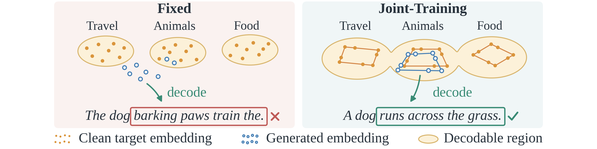

# One Latent, Many Tokens: Jointly Learning Compressed Embeddings for Efficient Language Diffusion

[](https://arxiv.org/abs/2609.33698)

JPEG-DLM (**J**oint-embedding **P**rediction for **E**fficient **G**eneration with **D**iffusion **L**anguage **M**odel) is a diffusion language model that jointly learns compressed embeddings for efficient and reliable text generation. Compression reduces the latent length, with one latent covering several tokens, so each sampling step is cheaper. Instead of fixing the compressed embedding space before training the diffusion model, JPEG-DLM jointly trains a compressor, a flow matching model and a decoding module. With joint-embedding prediction, it learns compressed embeddings that are more structured and easier to model with diffusion. In this way, JPEG-DLM generates compressed embeddings efficiently, and these embeddings can be reliably decoded into tokens, which leads to efficient text generation.

<p align="center">
  
</p>
<p align="center"><em>Fixed (left) and jointly learned (right) compressed embedding spaces.</em></p>

This repository contains the PyTorch implementation of JPEG-DLM. It includes pre-trained checkpoints on LM1B and OpenWebText (OWT) and the scripts to sample from them and evaluate the samples.

## Roadmap

- [x] [2026.09] Release inference code
- [ ] [Coming soon] Release training code

## Setup

Create a conda environment and install the dependencies:

```bash
conda create -n jpeg-dlm python=3.10 -y
conda activate jpeg-dlm
pip install -r requirements.txt
```

## Checkpoints

We provide pretrained JPEG-DLM checkpoints for LM1B (2× and 4× compression) and OpenWebText (2× compression).

| Dataset | Compression | Checkpoint |
|---|---|---|
| LM1B | 4× (default) | [LM1B-4×](https://huggingface.co/Seele-Yuan/JPEG-DLM/blob/main/jpeg_dlm_lm1b_r0.25.safetensors) |
| LM1B | 2× | [LM1B-2×](https://huggingface.co/Seele-Yuan/JPEG-DLM/blob/main/jpeg_dlm_lm1b_r0.5.safetensors) |
| OWT-1024 | 2× | [OWT-2×](https://huggingface.co/Seele-Yuan/JPEG-DLM/blob/main/jpeg_dlm_owt1024_r0.5.safetensors) |

## Sampling

The sampling scripts automatically download the selected checkpoint from Hugging Face. Use `--steps` to change the number of sampling steps and `--sc-scale` to set the self-conditioning scale.

### LM1B

Generate samples with the default 4× model:

```bash
bash scripts/generate_lm1b.sh
```

For 2× compression, select the matching configuration and checkpoint:

```bash
bash scripts/generate_lm1b.sh \
  --config configs/jpeg_dlm_lm1b_r0.5.yaml \
  --checkpoint checkpoints/jpeg_dlm_lm1b_r0.5.safetensors \
  --output outputs/lm1b_2x_generations
```

### OWT

```bash
bash scripts/generate_owt1024.sh
```

## Evaluation

| Dataset | Compression | Gen-PPL | Entropy | MAUVE |
|---|---:|---:|---:|---:|
| LM1B | 4× (default) | 85.80 | 4.263 | 0.947 |
| LM1B | 2× | 74.24 | 4.256 | 0.946 |
| OWT | 2× | 34.52 | 5.067 | 0.801 |

### LM1B

Evaluate the default 4× checkpoint:

```bash
bash scripts/eval_lm1b.sh
```

Evaluate the 2× checkpoint:

```bash
bash scripts/eval_lm1b.sh \
  --config configs/jpeg_dlm_lm1b_r0.5.yaml \
  --checkpoint checkpoints/jpeg_dlm_lm1b_r0.5.safetensors \
  --output outputs/lm1b_2x_eval
```

### OWT

```bash
bash scripts/eval_owt1024.sh
```

## Citation

If you find this work useful, please cite our paper:

```bibtex
@misc{yuan2026jpegdlm,
  title={One Latent, Many Tokens: Jointly Learning Compressed Embeddings for Efficient Language Diffusion},
  author={Yulin Yuan and Ying Zhang and Xiangming Meng},
  year={2026},
  eprint={2609.33698},
  archivePrefix={arXiv},
  primaryClass={cs.AI},
  url={https://arxiv.org/abs/2609.33698},
}
```

## Acknowledgements

Our implementation builds on [ELF](https://github.com/lillian039/ELF) and [COSMOS](https://github.com/MeshchaninovViacheslav/cosmos). We thank the authors for making their code publicly available.

## License

This project is released under the MIT License. See [LICENSE](LICENSE) for details.
